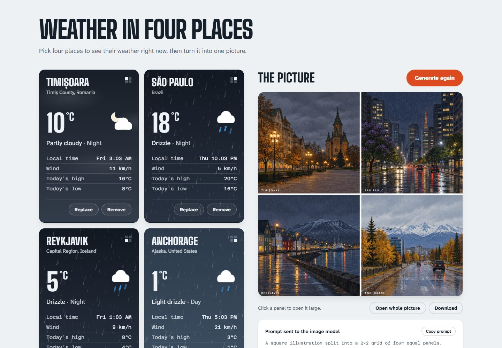

# Weather in four places

Pick four places, see their weather right now, and turn it into one AI-generated picture: a 2x2 grid with one panel per place, painted from the real weather and local time. The prompt is built in code from the weather data and shown under the picture.



## Run it

Needs Node.js 20.9 or newer and an OpenAI API key with credit.

```bash
git clone https://github.com/HaralambosARDELEAN/weather-dashboard.git
cd weather-dashboard
npm install
cp .env.example .env        # Windows (cmd): copy .env.example .env
```

Put your key in `.env` (`OPENAI_API_KEY=...`), then:

```bash
npm run dev                 # open http://localhost:3000
```

Tests: `npm test` (no network or key needed). Production build: `npm run build && npm start`. On every push, GitHub Actions runs the lint, type check, tests and build ([`ci.yml`](.github/workflows/ci.yml)).

The key is read only on the server and never sent to the browser. Without a key, the dashboard works and the picture panel says the key is missing.

## Choices

**Weather: [Open-Meteo](https://open-meteo.com/).** No key, and its geocoding returns region and country, which is what tells the many Springfields apart. Weather is requested in °C and km/h and in each place's own timezone, so "today's high and low" is that place's today. Its free API is for non-commercial use only; a client project would need one of their paid plans.

**Image model: OpenAI `gpt-image-2.5-flare`.** OpenAI's fast image model: a picture takes about 15–20 seconds and handles four labelled panels well. The model can be changed in `.env` (`OPENAI_IMAGE_MODEL`) without touching code. I first planned for `gpt-image-1`, but OpenAI shut it down on 23 October 2026.

**Next.js + TypeScript.** One process, API routes keep the key on the server, and it is the stack I know best.

How it fits together:

- The browser sends only the four place IDs to `/api/image`. The server looks up each place and its weather itself and builds the prompt, so every number in the prompt comes from the weather API and nothing can be injected from the browser.
- Every outside answer is checked with zod. Every outside call has a timeout (8 s for Open-Meteo, 90 s for the image model), and Open-Meteo is tried again when it is busy.
- No personal data is collected. The four places are saved only in the browser (localStorage), there are no accounts or cookies, and the fonts are served by the app itself, not by Google. Open-Meteo and OpenAI are called only from the server, so they never see the visitor's IP address.
- Failures stay local: a place that does not exist, a card whose weather does not load (with Try again), an image model that times out, refuses or has no credit. Each shows a clear message, and the rest of the dashboard keeps working.

## What does not work yet

- The picture is not kept after a reload. Only the four places are.
- The "low sun" sky colour uses the local clock (before 8:00, after 18:00), not the real sunrise and sunset, so it can be off in unusual time zones.
- The prompt rules reduce the model's mistakes but do not remove them. For example, Cairo sometimes gets autumn leaves it would not have.
- There is no limit on how often the picture can be generated, so anyone using a running copy can spend the key's credit.

## With one more day

In this order:

1. **A rate limit on `/api/image`.** Every picture costs money, and anyone who can open a running copy can spend the key's credit.
2. **End-to-end tests with Playwright, added to the CI:** search, generate and the failure messages, in a real browser. The current tests cover the logic and the API routes, not the page.
3. **Weather cached on the server for a few minutes:** fewer calls to Open-Meteo and faster reloads.
4. **Real sunrise and sunset** from Open-Meteo for the "low sun" colour, instead of the clock.
5. **Keep the last picture** after a reload.

## How I used AI

I built this with **Claude Code** (Anthropic's coding agent, model Claude Opus 5.5). I gave it the brief; we chose the stack and planned the design together before any code. It wrote most of the code and tests. I checked every step in the browser before each commit and asked for changes when something was wrong.

What I changed or threw away:

- Its first design, a cream "printed almanac" with a serif display face, looked like a typical AI template. We replaced it with cards coloured by the real sky at each place.
- It first drew weather-map station symbols (cloud-cover circles). They were unclear to me, so we drew normal weather icons.
- Its first frost effect looked like a spider web. It made four mock-ups and I picked one.
- I asked for the local time with AM/PM, cards that keep one size so the page does not jump, and the results list on top of the card below it, which it had hidden.
- The first plan sent whole place objects from the browser to the image route; we changed it to IDs only (see above).

What the image model got wrong, and how the prompt now constrains it. All of these were found by generating real pictures, and each rule has a test:

- **Cherry blossom in Tokyo at the end of October.** Each panel now states its season, by hemisphere, and none near the equator.
- **Flowers in Antarctica at -43 °C**, because it was spring there. Plants must match the temperature too: no flowers or green leaves below freezing.
- **Rain hardly visible, and wet streets under a dry night sky.** Rain and snow are described by what can be seen, and each panel states its ground (dry, wet, snow).
- Two guards added before seeing the failure: no landmarks from other places with the same name (Paris, Texas got its water tower, not the Eiffel Tower), and no snow on the ground in a warm "winter".

Problems caught by running the checks (the production build and real requests), not by reading the code: `next build` failed because the API routes read `request.url` inside a `try` block, which hid Next 16's "this route is dynamic" signal; and Open-Meteo answers 429 "Too many concurrent requests" when four cards load at once, which is why it is now tried again.

---

Weather data by [Open-Meteo](https://open-meteo.com/) (CC BY 4.0).
